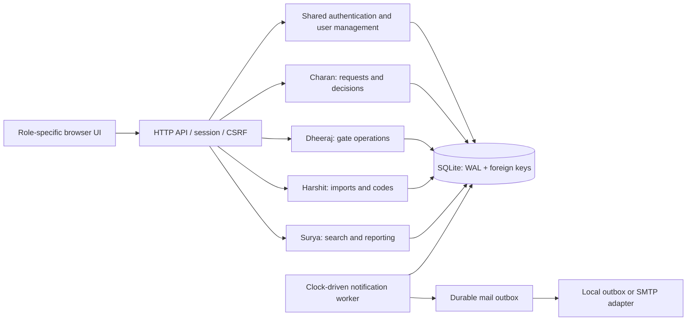
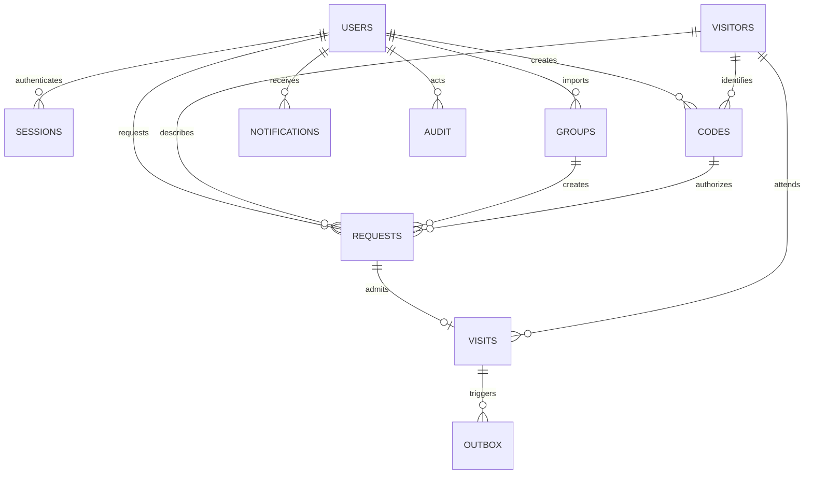
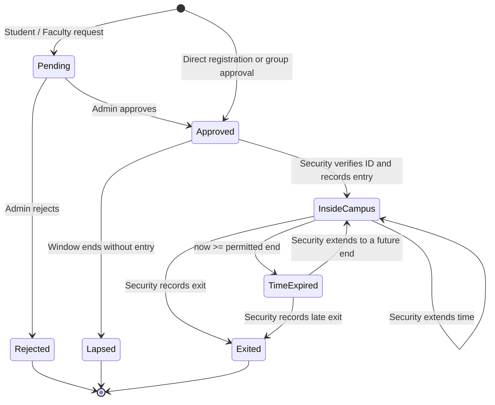

# System design and implemented principles

## Architecture

LOBBY is a modular monolith for the documented single-campus scope. A browser UI calls a same-origin Express API. Role checks and domain validation run on the server. Contributor-owned services share one relational database and transactional boundaries. A notification worker executes every 30 seconds and uses a durable outbox.

No frontend state is the source of truth for permission, approval, or occupancy. Refreshing the page or restarting the server preserves committed records. Browser storage is not used for passwords, session tokens, or visitor data.

## Principles tied to code

| Principle | Concrete implementation |
|---|---|
| Separation of concerns | HTTP composition in `app.js`; domain services in contributor modules; shared authentication, validation, and database helpers; UI in `public/` |
| Single responsibility | Gate transitions, import review, code validity, request decisions, reporting, and delivery live in separate modules |
| Dependency inversion / testability | Services accept a context containing database, clock, and mail adapter; tests inject a deterministic clock and delivery transport |
| Open extension points | `mailer.send()` supports local and SMTP transports without changing expiry rules; storage and HTTP boundaries are explicit |
| Least privilege / defense in depth | Server role checks, owner scoping, session expiry, session revocation, CSRF token, origin validation, HTTP-only cookie, CSP, Helmet, input limits |
| DRY | Common visitor/date validation, shared state query, reusable form fields, and one set of business rules for UI and tests |
| Relational integrity | Foreign keys, constrained roles/states, chronological checks, one visit per request, one active visit per visitor identity |
| Atomicity | Request creation, decisions, group approval, gate operations, extensions, and audit records commit together with `BEGIN IMMEDIATE` |
| Concurrency control | SQLite write transaction serialization and unique constraints prevent double gate entry and repeated approval; concurrent HTTP entry test verifies one success |
| Idempotent event creation | Unique notification keys and outbox event keys stop repeated timer checks from queuing duplicate reminder/expiry/escalation events |
| Reliability | WAL persistence, startup recovery of interrupted mail claims, bounded retry attempts, backup command, graceful shutdown |
| Observability | Health endpoint, durable actor/action audit records, visible notification/outbox states, delivery errors, test evidence |
| Bounded resource use | 1 MB JSON; 2 MB uploads; 1,000 import rows; 20 MB declared XLSX expansion; paginated searches; bounded message dispatch batches |
| Security of exports | CSV quoting and leading-formula neutralization; authenticated Admin-only export |
| Maintainability | Versioned database schema, locked dependencies, documented API, exact requirement IDs in acceptance tests |

These are the relevant implemented design principles; “all system design principles” is not a finite or meaningful certification. Distributed consensus, sharding, Kubernetes, and microservices are unnecessary for this local single-campus deliverable.

## Data model

`users` holds salted scrypt password hashes. `sessions` stores hashes of random session tokens plus a CSRF value, expiry, and user reference. Changes to user role/status/password invalidate their sessions. The client never chooses its own role.

`visitors` stores a snapshot of a person’s details for a request or repeat-use code. `requests` stores expected time, requester, source, decision, and optional group/code reference. `visits` stores actual entry/exit and the effective permitted end. Temporary-code visits reuse their visitor identity and receive separate request/visit rows each time; exited visits cannot be reopened. Normal separate requests remain independent records.

`groups.rows_json` is an isolated review staging area; only approval creates live visitor/request records. It retains reviewed input for traceability. Group review checks required columns, date/phone formats, duplicate phone/start combinations, malformed workbooks, and file/expansion limits.

Schema version 1 creates the relational model and indexes. Version 2 adds optional relationship and ID-reference fields from the later sequence diagram. The migrations execute on database opening; subsequent opens preserve data and skip applied version 2. Back up before making future schema changes.

## State machine

`Inside Campus`, `Time Expired`, and `Exited` are derived from actual timestamps in one shared query, rather than duplicated mutable status flags. An overstay event remains recorded even after extension. Expiry uses `now >= permitted_end`; entry is allowed only for `starts_at <= now < ends_at`. A code entry atomically creates an approved visit and records entry after validity and identity checks. Code visits cannot extend beyond the code’s expiry.

## Notifications and delivery guarantees

New requests notify Admin; decisions notify the requester and approvals also notify Security. Approved groups notify Security. Each visit can queue one pre-expiry reminder, one expiry message, and one escalation per Admin recipient. Missing visitor email means only in-app alerts are available; the UI states that an email address is needed for email alerts.

The worker claims queued messages before sending, retries failures up to five times, and recovers interrupted claims at startup. Exit cancels pending messages for that visit. The local adapter records `local`, never `sent`. SMTP success records `sent` after acceptance by the SMTP server, not after proof of inbox delivery.

Exactly-once external email delivery is not guaranteed: a crash after SMTP acceptance but before database acknowledgement can cause a retry. A stable Message-ID helps recipients deduplicate, but SMTP and SQLite do not share a transaction. This limitation is documented instead of claiming an impossible guarantee. Repeated normal scheduler checks are deduplicated and tested.

## Scope and operational limits

This is a single-node design with one application process and a local database. A 300-person import benchmark and basic concurrent entry test passed; high-volume campus load, multiple nodes, external SMTP reliability, and real institutional access/retention policy need environment-specific validation. For larger deployments, move storage to a server DB, use a dedicated worker with leases, place the service behind HTTPS, and preserve the tested domain boundaries.

Passwords are hashed, not encrypted. Visitor data at rest relies on local filesystem controls; encryption-at-rest and disaster recovery are infrastructure responsibilities. Account deletion is implemented as disabling to preserve audit/history relationships. Actual identity is checked by Security, as required by the SRS.
